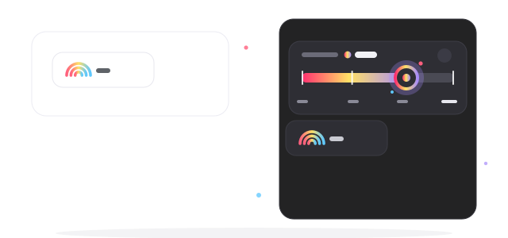

# 推理强度彩虹控件（DSH 插件）

> 本目录是 [DSH 插件集合](../../README.md) 里的一个插件；安装时选**这个子目录**，不是仓库根目录。

给 DeepSeek Harness（DSH）Web GUI 的 composer 加一个独立的「推理强度」控件，位置在**模型选择器正左侧**，不再需要点开模型菜单找 Effort。

- 收起态：彩虹弧线 icon + 当前档位短名（低 / 高 / 最大），完全静止，无动画。
- 悬浮 / 聚焦：上方浮出滑动变阻器面板 —— 无极拖动、松手吸附最近档位并提交，方向键可逐档切换。
- 四档配色参考 CS 武器品质：关闭=消费级灰、低=工业级蓝、高=受限级紫、最大=彩虹。
- 跟随宿主主题：浅色白面、深色黑面；动画只出现在展开的面板里。
- 档位来自当前模型公布的推理元数据；模型没有该元数据时不显示控件。



## 安装（另一台电脑）

插件是一个自包含的包，没有 npm 依赖，克隆下来即可安装。

```bash
git clone <本仓库地址> dsh-plugins
```

然后在 DSH 里二选一：

1. **图形界面**：Plugins（插件）→ Add plugin（添加插件）→ 选择本地目录 → 选中 `dsh-plugins/plugins/reasoning-effort-rainbow`。
2. **让 agent 装**：把路径告诉 DSH 里的 agent，说「把 /绝对路径/dsh-plugins/plugins/reasoning-effort-rainbow 装成插件」。

安装后刷新页面（⌘R）生效。

> 安装动作会在该机器的 profile 里写入一条 `link:/绝对路径` 依赖，所以**每台机器只需装一次**；直接复制 profile 目录到别的机器不行。

## 更新

插件以链接方式安装，代码直接读仓库目录：

```bash
git pull
```

然后在页面刷新（⌘R）即可加载新的 `client.js`。

## 结构（本目录）

| 文件 | 作用 |
| --- | --- |
| `package.json` | 包名、`dsh.bundle.patch`、`dsh.client`（web 半的加载顺序） |
| `cordis.patch.yml` | 向 profile 插入这一行插件 |
| `index.js` | Host 半，空实现（控件全在浏览器侧） |
| `client.js` | 浏览器半：读模型目录、渲染胶囊与变阻器、调 `session.selectModel` |
| `locale/*.json` | 插件页的标题 / 描述（英文、中文） |
| `icon.svg` | 插件页图标 |
| `docs/` | 详情页图片与说明 |

## 兼容性

- 针对 DSH `0.2.2-rc.3`（desktop profile）开发；依赖 `conversation.input.right` 插槽和 `ctx.modelDirectories`（ui-model-selection 暴露的会话级模型目录）。DSH 升级后这些接口若有变动需要跟着改。
- 只在该模型公布了推理档位时显示；地址化 subagent 会话不显示。
- 切换走 `session.selectModel`，与模型菜单共享同一份状态：任何一侧切换，另一侧立即同步。

## 开发

改 `client.js` 后刷新页面即可，无需构建（浏览器半是 `window.__ModuleLoader__` 的懒加载工厂）。语法自检：
`node --check client.js`。
